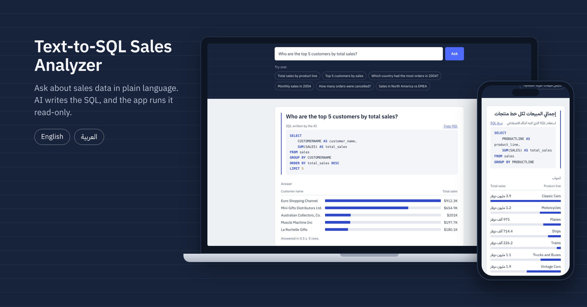
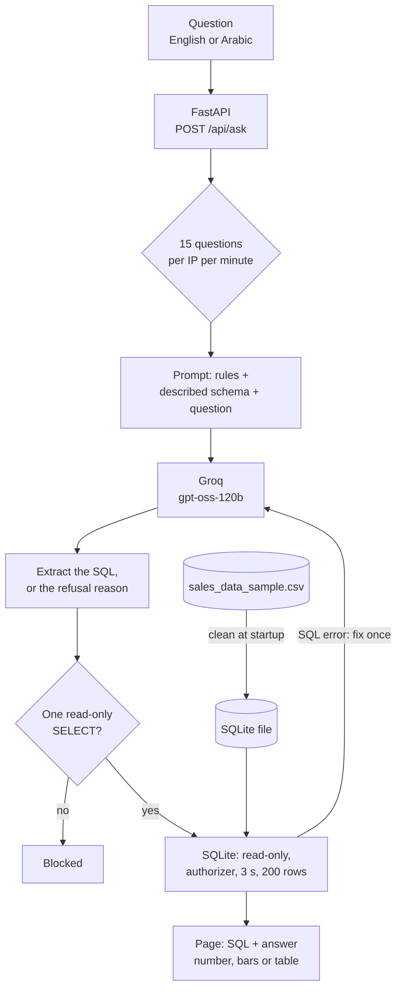
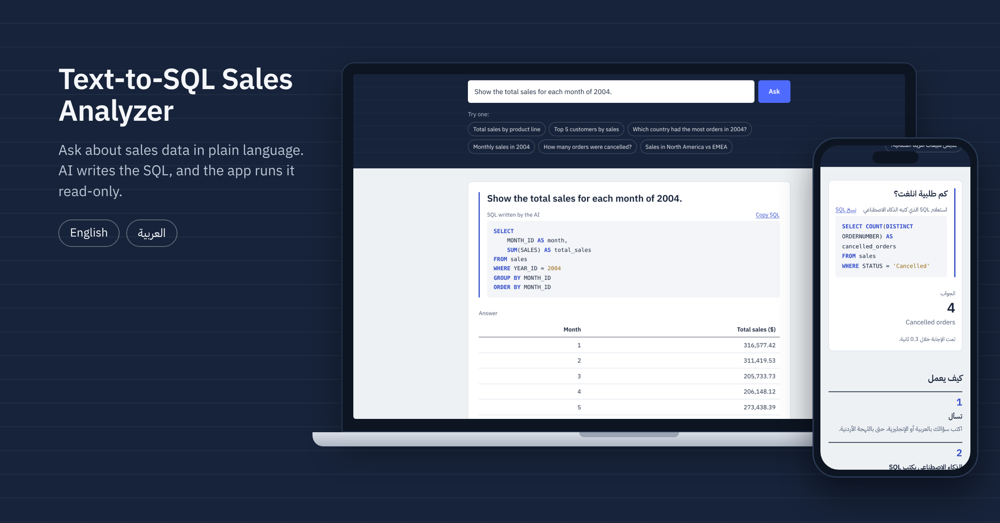

# Text-to-SQL Sales Analyzer

Ask questions about sales data in English or Arabic. An LLM writes the SQLite query, and the app checks it, runs it read-only and shows both the SQL and the answer.

**Live demo:** https://text-to-sql-sales-analyzer.onrender.com (free hosting, so the first load can take about a minute)



## The problem

Company data lives in SQL databases, but most people who need answers from it (managers, sales teams) don't write SQL. Asking an LLM to write the query is the obvious shortcut, but a naive version fails in quiet ways:

- It guesses what columns mean. In this dataset an order has several rows, `TERRITORY` uses `'NA'` for North America, and `PRICEEACH` is capped at 100. A model that doesn't know this returns confident, wrong numbers.
- It answers questions the data can't answer, for example by reporting revenue as "profit".
- It runs whatever it writes, including queries that change or delete data.

This project handles all three: it gives the model a described schema, tells it what the data doesn't contain, checks every query before running it, and measures the result on a fixed question set.

## Results

Execution accuracy on 22 questions, each asked in English and in Arabic (Modern Standard and Jordanian dialect). 18 questions can be answered from the table; 4 cannot, and the right behaviour is to refuse. Full report: [`reports/evaluation.md`](reports/evaluation.md).

| Model and prompt | Execution accuracy | English | Arabic | Refused unanswerable |
|---|---|---|---|---|
| **gpt-oss-120b, described schema** | **100% (36/36)** | 18/18 | 18/18 | **8/8** |
| gpt-oss-20b, described schema | 97.2% (35/36) | 18/18 | 17/18 | 7/8 |
| gpt-oss-120b, column names only | 86.1% (31/36) | 16/18 | 15/18 | 5/8 |

For gpt-oss-120b with the described schema: median time per question 0.54 s (model call plus query), about 1,180 tokens per question, no SQL errors, and the self-correction retry was never needed.

What the numbers show:

- **The schema description is what makes the difference.** With column names only, accuracy drops to 86.1% (83.3% in Arabic), and the misses are the data traps: `COUNT(*)` instead of distinct orders, `'North America'` instead of `'NA'`, `AVG(SALES)` instead of the average per order, and `'United States'` instead of `'USA'`.
- **gpt-oss-120b is the safer choice.** Both models answer almost the same, but gpt-oss-20b invented "sales reps" from the customers' contact names instead of refusing.
- **Error analysis during development:** asked for "profit per product line", the model returned `SUM(SALES) AS profit`. The prompt now lists what the table does not contain (costs or profit, salespeople, stock). Two more refusal questions that no note mentions (customer ratings, shipping time) check that the model refuses on its own, and it does.

## How it works



1. **Load and clean:** at startup the CSV is loaded with pandas. `"NA"` is kept as North America (pandas reads it as a missing value by default), and dates become `YYYY-MM-DD` so SQLite date functions work. The table is written to an SQLite file.
2. **Prompt:** the model gets rules, a description of every column (type, meaning, allowed values) and notes about the data's traps. It never sees the rows themselves.
3. **Generate:** `gpt-oss-120b` on Groq writes one query, through the OpenAI Python SDK pointed at Groq's OpenAI-compatible API. If the question can't be answered, it replies `CANNOT_ANSWER` with a short reason in the question's language.
4. **Check and run:** the query must be a single `SELECT` (or `WITH ... SELECT`) with no write or admin keywords. It then runs on a read-only connection, with an SQLite authorizer that only allows reading, a 3-second limit and at most 200 rows. If SQLite rejects it, the error goes back to the model once.
5. **Show:** the page shows the question, the SQL and the answer: a single number, a bar list for "label + number" results, or a table.

## Features

- Questions in English or Arabic, including Jordanian dialect; the page itself is bilingual (Arabic right-to-left), and opens in the browser's language.
- The generated SQL is always shown, with syntax highlighting and a copy button.
- Three layers of protection: text validation, an SQLite authorizer and a read-only connection.
- One self-correction attempt when SQLite rejects a query.
- Clear refusals with the model's reason, plus a "What's in the data" section showing real sample rows.
- Per-IP rate limit (15 questions a minute), with distinct messages for Groq's per-minute and per-day limits.
- `GET /api/health` for wake-up pings; it never calls the model.
- An evaluation that is resumable, throttled to the free tier, and re-runs results produced by an older prompt.

## Tech stack

- **Backend:** Python 3.13, FastAPI, Uvicorn, pandas, SQLite (`sqlite3`)
- **LLM:** Groq API (`openai/gpt-oss-120b`), OpenAI Python SDK
- **Frontend:** HTML, CSS and JavaScript (no framework), IBM Plex fonts served locally
- **Quality:** pytest (85 tests, no network needed), Ruff
- **Hosting:** Render (free web service)

## API

| Method | Path | What it does |
|---|---|---|
| `GET` | `/` | The web page |
| `GET` | `/api/health` | `{"status": "ok"}`, fast and without calling the model |
| `POST` | `/api/ask` | Body `{"question": "..."}`. Returns `sql`, `columns`, `rows`, `row_count`, `truncated`, `attempts`, `elapsed_ms`. Errors have a stable `error.code`, such as `unanswerable` (with `reason`), `unsafe_sql`, `sql_error`, `rate_limited` or `llm_busy`. |

## Dataset

[Sample Sales Data](https://www.kaggle.com/datasets/kyanyoga/sample-sales-data) on Kaggle (CC0, public domain): 2,823 order lines from 307 orders between January 2003 and May 2005. 92 customers in 19 countries buy scale models in 7 product lines. The data is fictional sample data based on the Classic Models sample database, and amounts are in US dollars. Each row is one product inside an order, and the table has 25 columns.

A few rows from the CSV, with 11 of the 25 columns (row 3 shows the `PRICEEACH` cap: 49 × 100 is not 5,205.27):

```csv
ORDERNUMBER,QUANTITYORDERED,PRICEEACH,SALES,ORDERDATE,STATUS,PRODUCTLINE,CUSTOMERNAME,COUNTRY,TERRITORY,DEALSIZE
10107,30,95.7,2871,2/24/2003 0:00,Shipped,Motorcycles,Land of Toys Inc.,USA,NA,Small
10121,34,81.35,2765.9,5/7/2003 0:00,Shipped,Motorcycles,Reims Collectables,France,EMEA,Small
10159,49,100,5205.27,10/10/2003 0:00,Shipped,Motorcycles,Corporate Gift Ideas Co.,USA,NA,Medium
10167,44,100,5924.16,10/23/2003 0:00,Cancelled,Classic Cars,Scandinavian Gift Ideas,Sweden,EMEA,Medium
10341,41,100,7737.93,11/24/2004 0:00,Shipped,Motorcycles,Salzburg Collectables,Austria,EMEA,Large
```



## Project structure

```
text-to-sql-sales-analyzer/
├── app/
│   ├── main.py          # FastAPI app: page, /api/health, /api/ask
│   ├── config.py        # settings from environment variables
│   ├── database.py      # load and clean the CSV, build SQLite, read-only connection
│   ├── prompt.py        # rules, described schema and data notes
│   ├── llm.py           # Groq client and error mapping
│   ├── sql_guard.py     # extract, validate and safely run the SQL
│   ├── text_to_sql.py   # the pipeline, with one self-correction retry
│   ├── rate_limit.py    # per-IP sliding-window limit
│   └── static/          # index.html, app.css, app.js, fonts/
├── data/sales_data_sample.csv
├── evaluation/
│   ├── questions.json   # 22 questions in English and Arabic, with gold SQL
│   ├── compare.py       # result comparison (execution accuracy)
│   ├── run_eval.py      # runs the models, resumable and throttled
│   └── report.py        # writes reports/evaluation.md
├── reports/             # evaluation.md and the raw results (runs/*.jsonl)
├── tests/               # pytest suite
├── assets/              # README images
├── requirements.txt, requirements-dev.txt, pyproject.toml
├── .env.example, .python-version, LICENSE
└── README.md
```

## Run it locally

Requires Python 3.11 or newer and a free [Groq API key](https://console.groq.com/keys).

```bash
git clone https://github.com/anaskasasbeh/text-to-sql-sales-analyzer.git
cd text-to-sql-sales-analyzer
python -m venv .venv
source .venv/bin/activate          # Windows (Git Bash): source .venv/Scripts/activate
pip install -r requirements.txt
cp .env.example .env               # then put your key in .env
uvicorn app.main:app --reload
```

Open http://127.0.0.1:8000.

### Tests and lint

```bash
pip install -r requirements-dev.txt
python -m pytest -q
ruff check .
```

### Evaluation

```bash
python -m evaluation.run_eval
```

This asks all 22 questions in both languages for three setups (gpt-oss-120b and gpt-oss-20b with the described schema, and gpt-oss-120b with column names only), then writes `reports/evaluation.md`. It waits between questions to stay inside Groq's free tier and takes about 20 minutes. If it stops, run it again: finished results are kept, and results from an older prompt are run again.

## Deploy on Render

| Setting | Value |
|---|---|
| Runtime | Python 3 (version from `.python-version`) |
| Build command | `pip install -r requirements.txt` |
| Start command | `uvicorn app.main:app --host 0.0.0.0 --port $PORT` |
| Environment variable | `GROQ_API_KEY` |
| Health check path | `/api/health` |

## Limitations

- One table with a hand-written description. A new dataset needs a new description.
- The evaluation set is small (22 questions) and was written for this project. Each setup was run once, and answers can change between runs: during development the Arabic "percentage" question returned 0.36 in one run and 36.16 in another, because «نسبة» can mean either.
- Groq's free tier gives the whole site about 8,000 tokens a minute and 200,000 a day. At about 1,180 tokens per question, that is roughly 6 questions a minute and 170 a day.
- The rate limit lives in memory: it resets when the server restarts, and it trusts the `X-Forwarded-For` header.
- Text values must match the data, for example customer names. The prompt lists the categories (countries, product lines, statuses), but not every customer or city.

## Future work

- Several tables with joins, for example the full Classic Models database, and generating the schema description automatically.
- Few-shot examples picked by similarity to the question.
- A larger evaluation, such as a subset of Spider or BIRD, with repeated runs.
- Follow-up questions that keep the conversation's context.

## License

MIT. The dataset is CC0.

Built by Anas Kasasbeh: [portfolio](https://anaskasasbeh.onrender.com), [LinkedIn](https://www.linkedin.com/in/anaskasasbeh).
